# SaleSway AI: architecture

How the system fits together, with diagrams of the main flows. The diagrams are Mermaid, which
GitHub draws on the page. Details live in the topic docs linked from each section.

- [1. System context](#1-system-context)
- [2. Inside the backend](#2-inside-the-backend)
- [3. Life of a request](#3-life-of-a-request)
- [4. Who sees what](#4-who-sees-what)
- [5. How the assistant answers](#5-how-the-assistant-answers)
- [6. Getting data in](#6-getting-data-in)
- [7. Background jobs](#7-background-jobs)
- [8. Predictions](#8-predictions)
- [9. Sign-in and sessions](#9-sign-in-and-sessions)
- [10. Data model](#10-data-model)
- [11. Build and deploy](#11-build-and-deploy)
- [12. Key decisions](#12-key-decisions)
- [13. Where the code is](#13-where-the-code-is)

## 1. System context

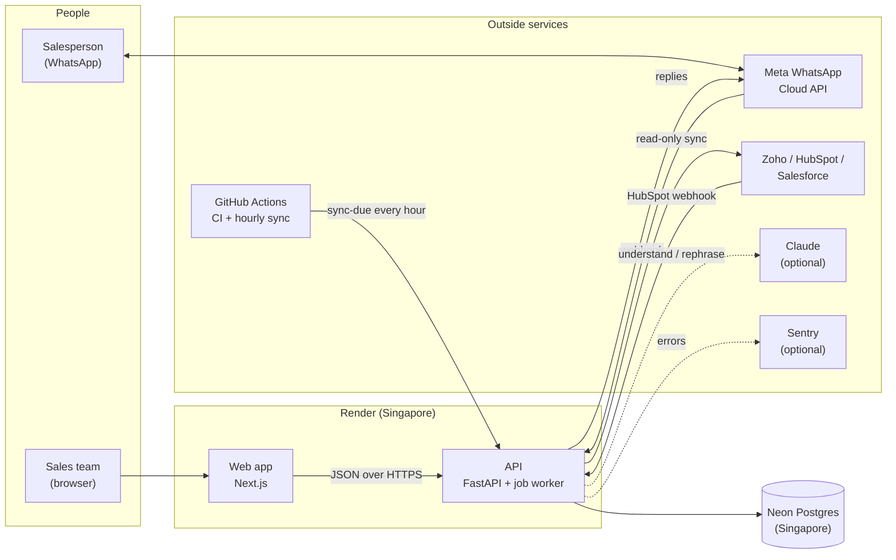

Two services and one database. The web app is a Next.js front end that renders in the browser and calls the API; everything else
(analytics, predictions, the assistant, imports, CRM sync and the background worker) is one
Python service, a *modular monolith*. Optional services are dotted: the app works without them
(the assistant falls back to rule-based understanding; errors go to the logs).

## 2. Inside the backend

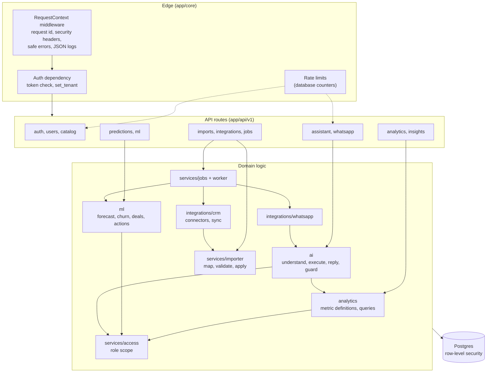

Routes stay thin; the logic sits in the domain modules, which the routes, the assistant and the
worker all share. Two examples of that sharing: the assistant answers with the same `analytics`
functions as the dashboard, and CRM sync feeds the same `importer` as file uploads.

## 3. Life of a request

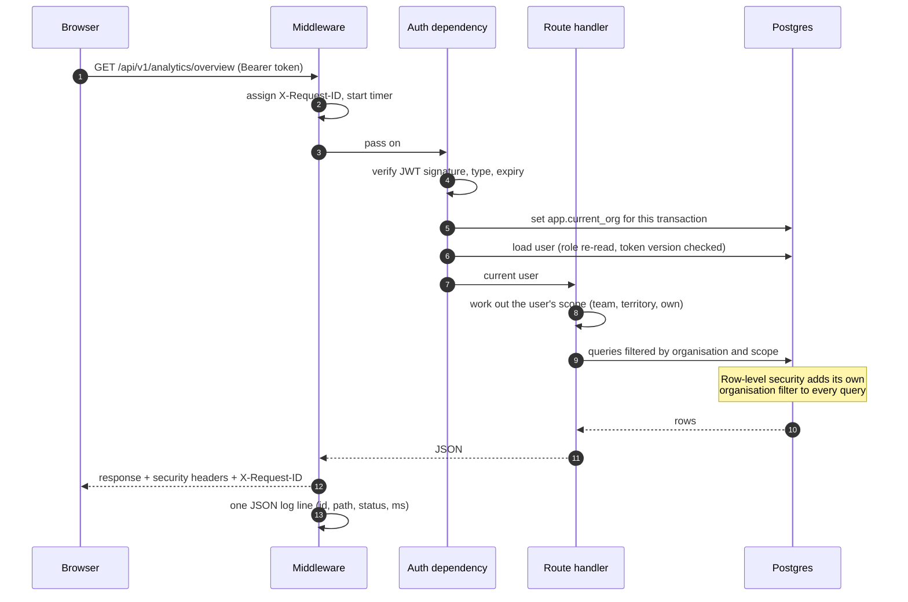

Role and organisation are always re-read from the database, never trusted from the token. If
anything unexpected fails, the user gets "Something went wrong on our side. Reference: <id>" and the
full error is logged under that id.

## 4. Who sees what

Every query is limited twice: by **organisation** (the application filter plus Postgres row-level
security) and by **role**.

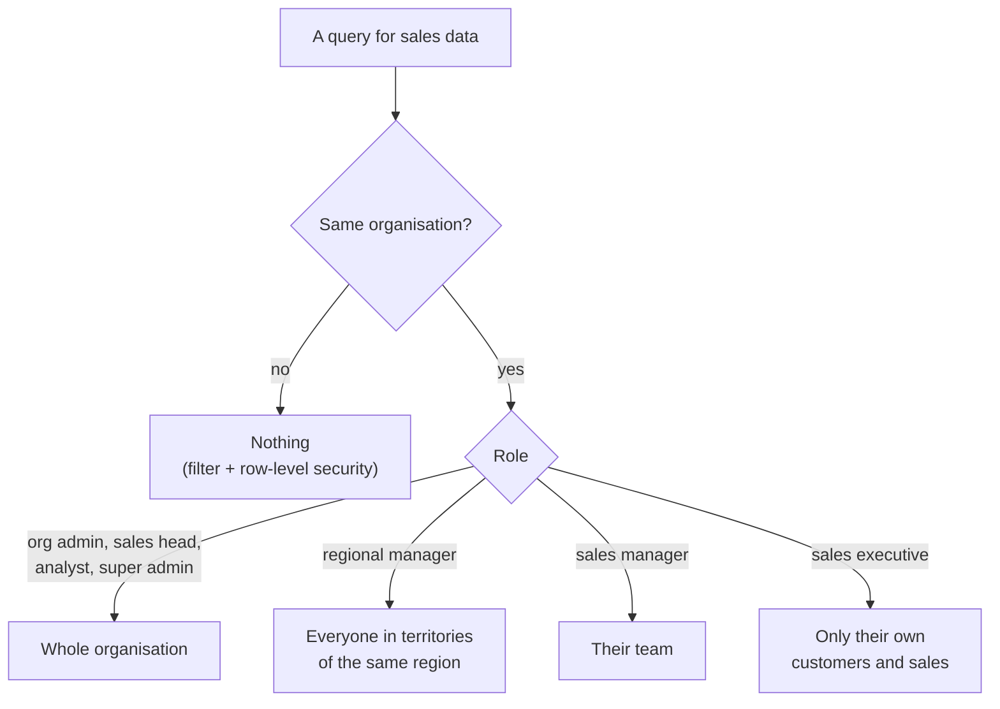

See [security.md](security.md#keeping-each-organisations-data-separate) for how row-level security
is set per transaction, and for the explicit cross-organisation lookups (sign-in, webhooks).

## 5. How the assistant answers

The language model **never writes SQL and never calculates numbers**. It only turns the question
into a fixed schema; code computes the facts; and any model-written reply is checked against those
facts before it is sent.

```mermaid
flowchart LR
    Q["Question<br/>web or WhatsApp"] --> I{"Interpret"}
    I -- "rules (default)" --> S["Interpretation<br/>1 of 15 intents,<br/>periods, names"]
    I -- "Claude (optional),<br/>falls back to rules" --> S
    S --> F["Merge with previous<br/>question (30 min)"]
    F --> C["Resolve names against<br/>what the user may see"]
    C --> E["Execute<br/>same analytics as dashboard,<br/>scope enforced again"]
    E --> FA["Facts"]
    FA --> T["Template reply"]
    T --> P{"Model enabled?"}
    P -- "no" --> OUT["Reply"]
    P -- "yes" --> RW["Claude rewrites<br/>tone, Hinglish"]
    RW --> G{"Every number<br/>in the facts?"}
    G -- "yes" --> OUT
    G -- "no" --> T2["Discard, send template"] --> OUT
    OUT --> REC["Store question, answer, facts,<br/>provider, grounded flag + audit"]
```

More in [assistant.md](assistant.md).

## 6. Getting data in

Two routes in, one pipeline: files and CRM records both go through the same mapping, validation,
de-duplication and owner matching.

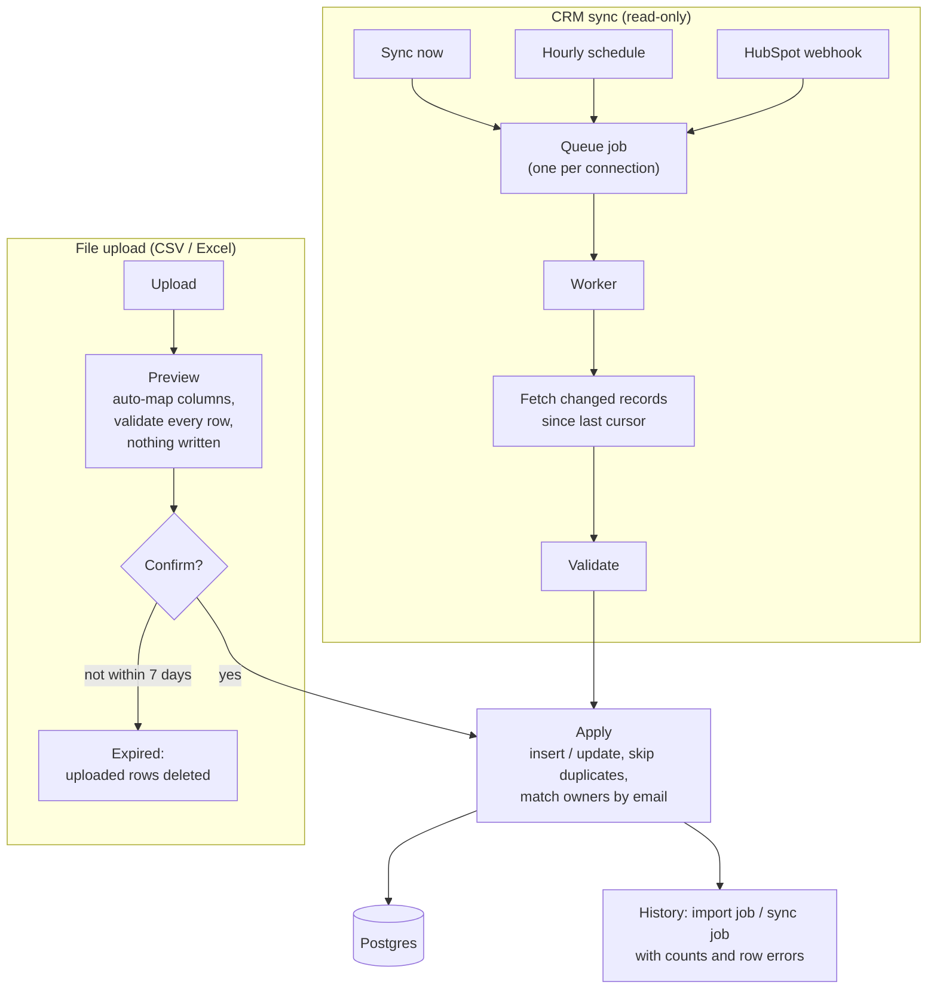

Order matters for files: customers, then products, then orders, then targets. Nothing is ever
written back to a CRM. More in [integrations.md](integrations.md).

## 7. Background jobs

Slow work (CRM syncs, model retraining, WhatsApp replies) runs in a queue kept in Postgres, so
web requests return at once and no Redis or Celery is needed.

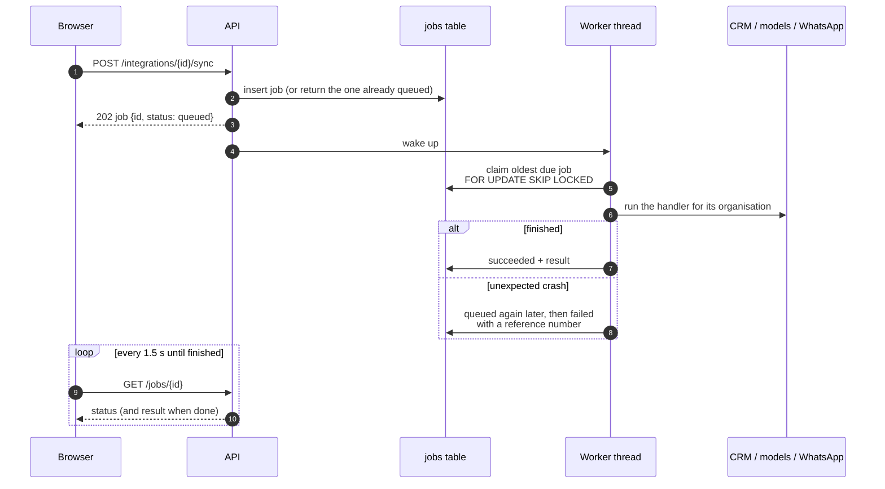

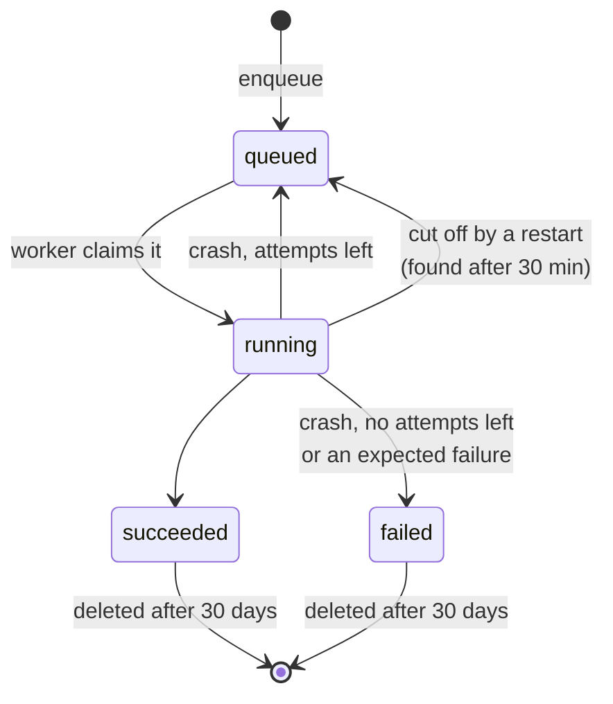

Every 15 minutes the worker also does housekeeping: picking up jobs cut off by a restart, and
deleting expired import previews, old jobs, expired refresh tokens and old rate-limit counts.
More in [security.md](security.md#background-jobs).

## 8. Predictions

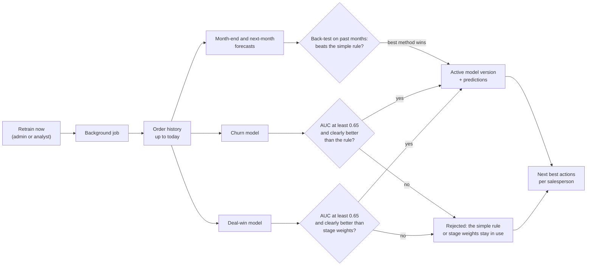

Every model version is kept with how it scored on data it didn't learn from, and the page says
plainly when a model isn't good enough to use. More in [predictions.md](predictions.md).

## 9. Sign-in and sessions

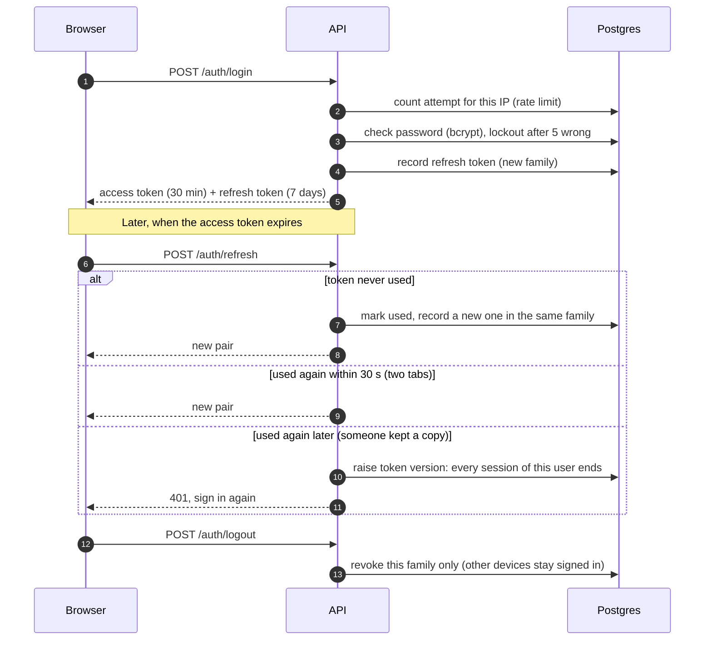

Changing a password, an admin reset, deactivation or a role change also raises the token version,
which ends every session at once. More in [security.md](security.md#sign-in).

## 10. Data model

Every table except `organizations` and `rate_limit_counters` has an `organization_id` and is
protected by row-level security (the relation to `organizations` is left out below for clarity).

**Sales data**: people, customers, what they bought, deals and visits.

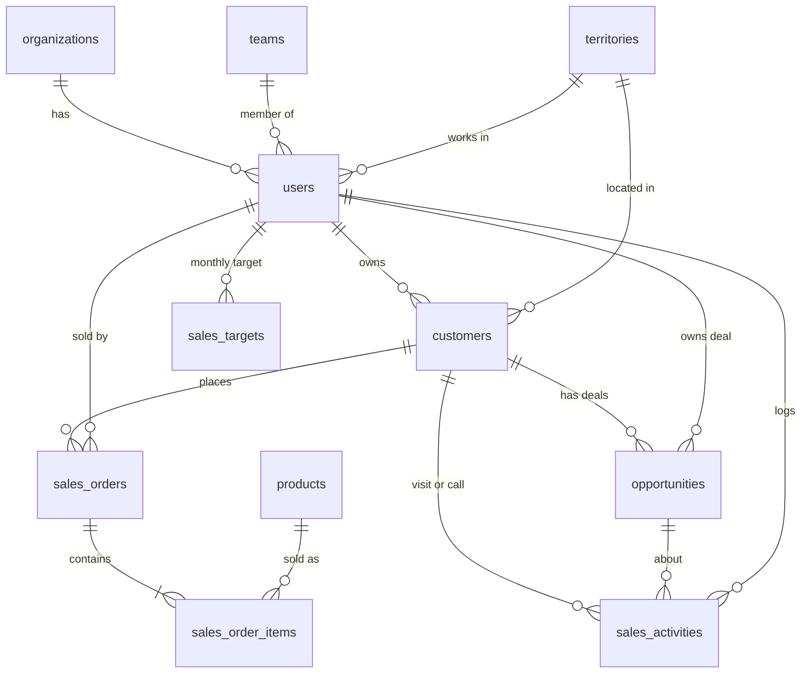

**The app's own records**: predictions, the assistant, connections, background work, security.

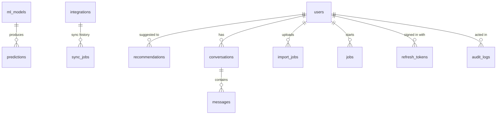

Other tables: `whatsapp_accounts` (which business number belongs to which organisation) and
`rate_limit_counters` (not per organisation; keys are users and IP addresses). Predictions and
recommendations point at customers or deals by id. Revenue is the sum of
`sales_order_items.line_amount`, which excludes tax. Metric definitions are in
[metrics.md](metrics.md).

## 11. Build and deploy

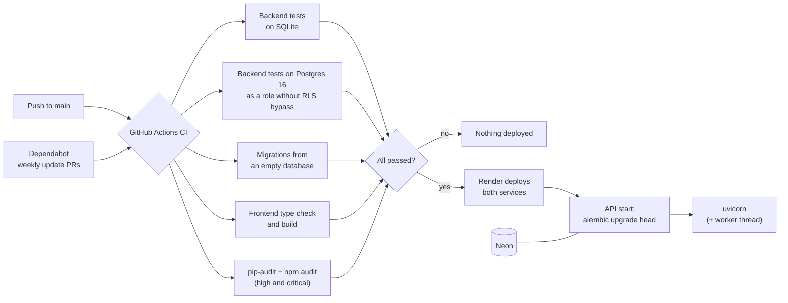

The free plan stops the API after 15 idle minutes; the first request then waits about a minute.
The login page wakes the API as soon as it opens. Setup steps are in
[deployment.md](deployment.md).

## 12. Key decisions

| Decision | Chosen | Instead of | Why |
| --- | --- | --- | --- |
| Shape of the backend | One modular Python service | Microservices | One team, one deploy, shared domain logic; modules can split later along existing boundaries |
| Tenant isolation | Shared tables + application filters + Postgres row-level security | Database or schema per customer | Cheap to run, simple migrations; RLS fails closed if a filter is forgotten |
| AI and numbers | Model interprets and rephrases; code computes; replies checked for invented numbers | Text-to-SQL, or letting the model answer | Sales decisions need numbers that are always right and within the user's permissions |
| Machine learning | Back-tested methods and an accuracy gate; simple rules as the fallback | Always using the most complex model | Small companies have little history; a wrong prediction is worse than an honest "not enough data" |
| Slow work | Job queue in Postgres (`SKIP LOCKED`) with an in-process worker | Redis + Celery | No new infrastructure on the free plan; can move to a separate worker process unchanged |
| CRM access | Read-only, through the same importer as files | Two-way sync | No risk of damaging customers' CRM data; one validation path |
| Sessions | Short access tokens + single-use refresh tokens with reuse detection | Long-lived tokens | A stolen refresh token is detected and shuts every session |
| Money | `Numeric` columns, `Decimal` in Python, revenue excluding tax | Floats | No rounding drift in totals |
| Hosting | Render + Neon free plans (Singapore) | A cloud account to manage | Zero cost for the demo; India hosting is a later step for customers that need it |

## 13. Where the code is

```
backend/app/
  main.py                 app setup, lifespan (starts the worker)
  worker.py               background job runner (thread, or `python -m app.worker`)
  core/                   config, database + row-level security, auth, passwords, rate limits, observability
  api/v1/                 HTTP routes (thin)
  models/                 SQLAlchemy tables
  schemas/                request and response shapes
  services/               importer, access (role scope), audit, jobs queue + job handlers
  analytics/              metric definitions, periods, dashboard and insight queries
  ai/                     assistant: nlu, catalog, executor, responder, guardrails, providers, orchestrator
  ml/                     forecast, churn, deals, recommendations, training, serving
  integrations/crm/       Zoho, HubSpot, Salesforce, Sandbox connectors + sync
  integrations/whatsapp/  webhook parsing, signatures, sending, message handling
  tests/                  pytest suite (runs on SQLite and on Postgres with RLS)
backend/migrations/       Alembic migrations
frontend/src/
  app/                    Next.js pages
  components/             app shell, charts, filters, shared UI
  lib/                    API client (token refresh, background jobs), auth, formatting
docs/                     this file and the topic docs
```
